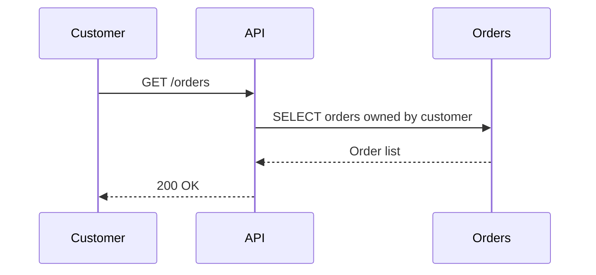

# Writing Specs

Write feature or application specifications as separate Markdown documents by type. Use the user's language for the generated documents. FSD describes the required behavior; TSD describes the technical design that implements it.

## Scope

This skill applies only to writing or revising specification documents in the repository's `docs/specs/` directory. Reading specifications for implementation, debugging, code review, or planning does not activate this skill. Its document structure, naming rules, and required document types do not apply to briefs, plans, README files, or other non-specification documents.

## Required documents

| Type | When to create | Content to cover |
|---|---|---|
| FSD — Functional Specification Document | Required for every feature/application specification | Goals, scope and exclusions, actors/access rights, main and alternative flows, business rules, validation, empty/error states, and verifiable acceptance criteria. |
| TSD — Technical Specification Document | Required for every feature/application specification | Components and responsibilities, integrations/dependencies, relevant API or interface contracts, technical flows, error handling, nonfunctional requirements, and verification strategy. |
| DRD — Data Requirements Document | Required whenever a database is involved | Data requirements, entities and relationships, data dictionary, integrity, access patterns, ownership/access rights, and impact on existing data. |
| ERD — Entity Relationship Diagram | When requested or when data relationships need a diagram | Entities, keys, relationships, cardinality, and explanations; reference the DRD. |
| DFD — Data Flow Diagram | When requested or when data movement needs a diagram | Sources/destinations, processes, data stores, data flows, and system boundaries. |

A DRD is required for reading, writing, deleting, integrating, or migrating database data, including using existing tables without schema changes. If no database is involved, do not create a DRD; state this briefly in the TSD. An ERD/DFD does not replace a DRD. Add other document types only as needed or requested.

Do not combine FSD, TSD, and DRD into one file. A request for brevity or a tight deadline can be met with short documents that remain separate.

## Filenames and location

All output documents must use this exact pattern:

```text
{yyyy-mm-dd}_{TYPE}_{name-of-the-feature-or-app}.md
```

- Use uppercase TYPE, such as `FSD`, `TSD`, `DRD`, `ERD`, or `DFD`.
- Use a lowercase, hyphen-separated feature/application slug. Separate the date, type, and slug with one literal underscore; do not include asterisks.
- **All documents referring to the same feature or application must have exactly the same date and slug. Only TYPE changes between filenames.** This applies to FSD, TSD, DRD, ERD, DFD, standalone UML, and any other related document type.
- When starting a specification set, choose the date and slug once and reuse them throughout. Use the user's local creation date or the date explicitly requested, rather than the host's UTC date if it differs.
- Before adding a document to an existing set, inspect the related filenames and reuse their date and slug exactly, **even when the new document is created on a later day**. Do not substitute today's date, abbreviate the slug, translate it, or add a type-specific suffix. Record later creation/revision dates in the document content.
- On revision, update the relevant set and preserve its filename date and slug. Do not overwrite an unrelated document that happens to have the same filename.
- Save all specification documents produced by this skill only in `docs/specs/` at the repository root, including standalone ERD, DFD, and UML Markdown documents. Create the directory if it does not exist. The skill folder stores instructions rather than product specifications.

Example of documents for the same application:

```text
docs/specs/1970-01-31_FSD_this-new-app-called-test.md
docs/specs/1970-01-31_TSD_this-new-app-called-test.md
docs/specs/1970-01-31_DRD_this-new-app-called-test.md
docs/specs/1970-01-31_ERD_this-new-app-called-test.md
docs/specs/1970-01-31_DFD_this-new-app-called-test.md
```

If the DFD is added later, it still uses `1970-01-31_DFD_this-new-app-called-test.md`.

## Writing the content

Read the relevant requirements, specifications, architecture, contracts, and project schemas. Distinguish verified facts, proposed designs, assumptions, and open questions; do not invent schemas or business decisions. Clarify only information that blocks the design while continuing with the parts that are already clear.

Start each document with a title, type, date, status, scope, and relative links to related documents. Assign requirement IDs in the FSD, such as `FR-001`, and reference them from the TSD/DRD so requirements, designs, and verification can be traced. Keep details in their owning document and use links instead of copies that may diverge.

In the DRD, describe fields, meanings, types, nullability, defaults, primary/foreign keys, uniqueness, constraints, and relationships according to the available information. Discuss query/index requirements, transactions/consistency, volume, retention, and migration/backfill only when relevant. Distinguish existing data from new requirements; explicitly state when the schema remains unchanged. Keep unknown details as open questions.

## Diagrams

Add a diagram only when it explains a flow or structure better than prose; simple CRUD flows do not need one. Embed a **sequence diagram** in the owning document (usually the FSD "main flow" or the TSD "technical flow" section) whenever the flow spans multiple actors, services, or system boundaries — for example token issuance/consumption, cross-application calls, callback/redirect chains — or when ordering and failure paths carry rules that prose alone makes easy to miss. Keep the diagram consistent with the prose; if they describe different behavior, one of them is wrong.

When using UML, write **Mermaid** source inside a `mermaid` fenced code block (`sequenceDiagram`, `classDiagram`, `erDiagram`, `flowchart`, `stateDiagram`, as appropriate). Do not ship an image, a rendered file, or an external DSL such as PlantUML without source, unless the user explicitly asks for PlantUML in that request.



UML may be embedded in the relevant FSD/TSD. If an ERD, DFD, or UML diagram is a standalone deliverable, create a separate `.md` file with the corresponding TYPE and the same date/slug as its related specifications; keep diagram source inside Markdown. Mermaid `erDiagram` and `flowchart` may be used for ERD/DFD; ERD/DFD are not automatically UML. Rendering or `.puml` files are unnecessary unless requested.

## Checks before completion

Ensure all specification documents are in `docs/specs/`, FSD and TSD exist as separate files, a DRD exists whenever a database is involved, filenames match the pattern, **every document for the same feature/application shares an identical date and slug**, relative links are valid, diagrams whose flow spans multiple actors or boundaries include a sequence diagram and use Mermaid, and scope/business rules/contracts/data are consistent. Report the files created or updated and any assumptions or open decisions that need the user's attention.
