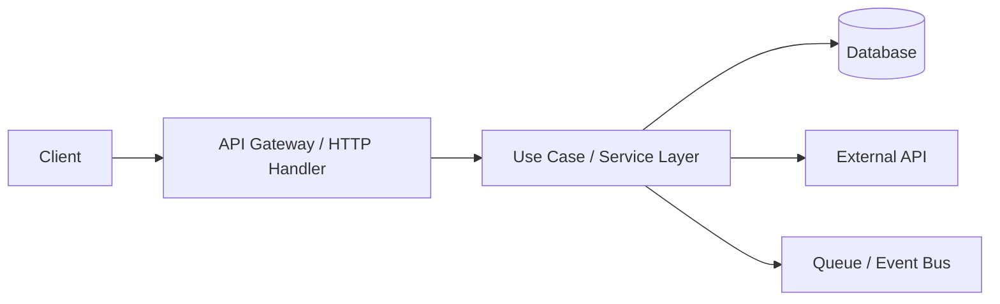

# Template Spesifikasi Boilerplate Golang (Rakkume)

> Dokumen ini adalah template. Duplikat file ini untuk setiap service/proyek baru, lalu isi semua bagian bertanda `[WAJIB DIISI]`.

## 1. Informasi Umum

- Nama Proyek/Service: `[WAJIB DIISI]`
- Kode Proyek (opsional): `[DIISI JIKA ADA]`
- Owner Teknis: `[WAJIB DIISI]`
- Tim Terkait: `[WAJIB DIISI]`
- Tanggal Dibuat: `[YYYY-MM-DD]`
- Versi Dokumen: `v0.1.0`
- Status: `Draft | In Progress | Approved | Deprecated`

## 2. Latar Belakang

### 2.1 Problem Statement
Jelaskan masalah bisnis/teknis yang ingin diselesaikan.

### 2.2 Tujuan
- `[WAJIB DIISI]`
- `[WAJIB DIISI]`
- `[WAJIB DIISI]`

### 2.3 Non-Tujuan
- `[WAJIB DIISI]`
- `[WAJIB DIISI]`

### 2.4 Definisi Sukses
- KPI Teknis: `[contoh: p95 < 300ms, error rate < 0.5%]`
- KPI Produk/Bisnis: `[WAJIB DIISI]`

## 3. Ruang Lingkup

### 3.1 In Scope
- `[WAJIB DIISI]`
- `[WAJIB DIISI]`

### 3.2 Out of Scope
- `[WAJIB DIISI]`
- `[WAJIB DIISI]`

## 4. Gambaran Solusi

### 4.1 Ringkasan Arsitektur
Jelaskan pendekatan utama (mis. modular monolith, clean architecture, hexagonal, dsb).

### 4.2 Diagram Arsitektur (opsional tapi disarankan)


### 4.3 Trade-off dan Keputusan Desain
- Keputusan: `[WAJIB DIISI]`
- Alternatif yang dipertimbangkan: `[WAJIB DIISI]`
- Alasan memilih pendekatan ini: `[WAJIB DIISI]`

## 5. Struktur Proyek

### 5.1 Struktur Folder yang Disepakati
```text
.
|- cmd/
|  |- <app_name>/
|     |- http/
|- internal/
|  |- app/
|  |  |- <module>/
|  |     |- delivery/
|  |     |- usecase/
|  |     |- repository/
|  |     |- entity/
|  |- pkg/
|- pkg/
|  |- constant/
|  |- model/
|- docs/
|  |- spec/
|  |- plan/
|- scripts/
```

### 5.2 Aturan Batasan Dependency
- `cmd` hanya wiring/bootstrapping.
- `delivery` boleh memanggil `usecase`, tidak boleh langsung ke `repository`.
- `usecase` berisi business rule inti.
- `repository` menangani I/O (DB, cache, external services).
- Hindari import silang antar module domain kecuali lewat interface/contract yang jelas.

## 6. Kontrak dan Interface

### 6.1 API Contract
- Protocol: `REST | gRPC | GraphQL | Internal`
- Auth Scheme: `[JWT/OAuth2/API Key/None]`
- Versioning: `[contoh: /v1]`

Contoh tabel endpoint:

| Method | Path | Deskripsi | Auth | Request | Response |
|---|---|---|---|---|---|
| GET | /v1/health | Health check | No | - | 200 OK |
| POST | /v1/... | `[WAJIB DIISI]` | Yes/No | JSON | JSON |

### 6.2 Interface Internal
Daftar interface utama lintas package:

| Interface | Lokasi | Fungsi | Implementasi |
|---|---|---|---|
| `[WAJIB DIISI]` | `[path]` | `[WAJIB DIISI]` | `[WAJIB DIISI]` |

## 7. Data dan Persistensi

### 7.1 Sumber Data
- Primary DB: `[PostgreSQL/MySQL/MongoDB/dll]`
- Cache: `[Redis/None]`
- Message Broker: `[Kafka/RabbitMQ/NATS/None]`

### 7.2 Skema Data Inti
Jelaskan entitas utama dan relasinya.

### 7.3 Migrasi
- Tool migrasi: `[goose/golang-migrate/custom]`
- Strategi rollback: `[WAJIB DIISI]`

## 8. Konfigurasi dan Environment

### 8.1 Daftar Environment Variable

| Variable | Wajib | Default | Contoh | Deskripsi |
|---|---|---|---|---|
| APP_ENV | Yes | development | production | Runtime environment |
| APP_PORT | Yes | 8080 | 8080 | Port aplikasi |
| `[VAR_LAIN]` | Yes/No | `[nilai]` | `[contoh]` | `[WAJIB DIISI]` |

### 8.2 Strategi Config
- Urutan prioritas: `env > file config > default`
- Validasi saat startup: `[WAJIB DIISI]`

## 9. Error Handling dan Logging

### 9.1 Error Handling
- Gunakan error wrapping (`fmt.Errorf("...: %w", err)`) agar root cause terlacak.
- Tetapkan mapping error domain -> error transport (HTTP/gRPC status).
- Standarisasi error response.

### 9.2 Logging
- Format log: `JSON` (disarankan untuk production).
- Level: `debug | info | warn | error`.
- Field wajib: `trace_id`, `request_id`, `module`, `operation`.

## 10. Observability

### 10.1 Metrics
- Contoh: request count, latency histogram, dependency call error.

### 10.2 Tracing
- OpenTelemetry: `[enabled/disabled]`
- Exporter: `[OTLP/Jaeger/Zipkin]`

### 10.3 Health Check
- Liveness endpoint: `[WAJIB DIISI]`
- Readiness endpoint: `[WAJIB DIISI]`

## 11. Keamanan

- Mekanisme autentikasi: `[WAJIB DIISI]`
- Mekanisme otorisasi: `[WAJIB DIISI]`
- Validasi input: `[WAJIB DIISI]`
- Secret management: `[Vault/K8s Secret/.env terenkripsi/dll]`
- Audit log (jika perlu): `[WAJIB DIISI]`

## 12. Kinerja dan Skalabilitas

- Target throughput: `[WAJIB DIISI]`
- Target latency p95/p99: `[WAJIB DIISI]`
- Batas resource (CPU/RAM): `[WAJIB DIISI]`
- Strategi scaling: `[vertical/horizontal/autoscaling]`

## 13. Strategi Testing

### 13.1 Unit Test
- Scope: `usecase`, utilitas, domain rule.
- Target coverage: `[contoh: minimal 80% pada package inti]`

### 13.2 Integration Test
- Scope: repository + DB + external dependency mock/stub.

### 13.3 End-to-End / Contract Test
- Scope: API contract utama.

### 13.4 Test Command
```sh
go test ./...
```

## 14. CI/CD dan Release

### 14.1 Pipeline Minimum
- Lint
- Unit test
- Build
- Security scan (opsional tapi direkomendasikan)

### 14.2 Strategy Branching
- `[GitFlow/Trunk Based/Custom]`

### 14.3 Deployment
- Environment: `dev -> staging -> production`
- Approval gate: `[WAJIB DIISI]`
- Rollback plan: `[WAJIB DIISI]`

## 15. Rencana Implementasi

| Fase | Aktivitas | PIC | Estimasi | Status |
|---|---|---|---|---|
| 1 | Setup skeleton project | `[nama]` | `[x hari]` | Todo |
| 2 | Implement core module | `[nama]` | `[x hari]` | Todo |
| 3 | Testing + hardening | `[nama]` | `[x hari]` | Todo |
| 4 | Release | `[nama]` | `[x hari]` | Todo |

## 16. Risiko dan Mitigasi

| Risiko | Dampak | Probabilitas | Mitigasi | Owner |
|---|---|---|---|---|
| `[WAJIB DIISI]` | Low/Med/High | Low/Med/High | `[WAJIB DIISI]` | `[nama]` |

## 17. Checklist Kesiapan

- [ ] Scope dan non-scope sudah disetujui.
- [ ] API contract sudah direview.
- [ ] Skema data dan migrasi siap.
- [ ] Logging + metrics + tracing terpasang.
- [ ] Test plan dan acceptance criteria jelas.
- [ ] Rollback plan terdokumentasi.
- [ ] Dokumen operasional (runbook) tersedia.

## 18. Acceptance Criteria

- `[WAJIB DIISI]`
- `[WAJIB DIISI]`
- `[WAJIB DIISI]`

## 19. Lampiran

### 19.1 Glossary
| Istilah | Definisi |
|---|---|
| `[WAJIB DIISI]` | `[WAJIB DIISI]` |

### 19.2 Referensi
- RFC/ADR: `[link/dokumen internal]`
- Issue tracker: `[link]`
- Repository: `[link]`

---

## Cara Pakai Cepat

1. Isi bagian 1-4 untuk menyepakati tujuan dan solusi.
2. Lengkapi bagian 5-12 agar tim dev punya kontrak teknis yang jelas.
3. Isi bagian 13-18 sebagai gate sebelum implementasi dan release.
4. Ubah status dokumen sesuai progres (`Draft` -> `In Progress` -> `Approved`).
