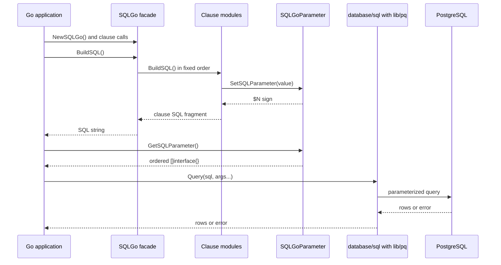

# Technical Specification Document: sqlgo

| Field | Value |
|---|---|
| Document type | TSD |
| Date | 2026-11-04 |
| Status | Draft |
| Scope | Technical design of the sqlgo query builder library |
| Related documents | [FSD](./2026-11-04_FSD_sqlgo.md), [DRD](./2026-11-04_DRD_sqlgo.md) |

## 1. Architecture Overview

`sqlgo` is a single Go package at the repository root. It has four parts:

1. A facade (`sqlGo`) that implements the `SQLGo` interface and owns the clause modules and the parameter registry.
2. One module per SQL clause. Each module exposes a public interface (`SQLGo<Clause>`), has a private implementation (`sqlGo<Clause>`), and implements `SQLGoBase`.
3. A parameter registry (`sqlGoParameter`) that assigns placeholders and keeps the ordered argument slice.
4. Small utilities (`combineSQL`, `hash`) used by the facade and registry.

The facade wires every module together in `BuildSQL()`. Each module builds its own fragment, registers values into the shared registry, and returns a string. `combineSQL` joins the fragments in a fixed order.

## 2. Component Responsibilities

| File | Responsibility |
|---|---|
| `sqlgo.go` | Facade, `NewSQLGo()`, module setters, delegation methods, `BuildSQL()` composition, dialect constants, value identity helpers. |
| `sqlgo_insert.go` | INSERT table, columns, value rows, and `to_tsvector` values. |
| `sqlgo_update.go` | UPDATE table, assignment list, and `to_tsvector` assignment. |
| `sqlgo_delete.go` | DELETE table target. |
| `sqlgo_select.go` | SELECT projection, aliases, `DISTINCT ON`, `ts_rank`, `similarity`, embedding, and embedding array. |
| `sqlgo_from.go` | FROM table, alias, optional column list, and subquery source. |
| `sqlgo_join.go` | JOIN type, table or subquery, alias, and join condition. |
| `sqlgo_where.go` | WHERE conditions, connectors, special operators, `BETWEEN`, groups, `to_tsquery`, and `similarity`. |
| `sqlgo_values.go` | Standalone VALUES rows. |
| `sqlgo_group_by.go` | GROUP BY list. |
| `sqlgo_order.go` | ORDER BY list and embedding ordering. |
| `sqlgo_offset_limit.go` | OFFSET, LIMIT, and page helper. |
| `sqlgo_schema.go` | Schema prefix. |
| `sqlgo_parameter.go` | Parameter registry, deduplication map, and placeholder generation. |
| `util.go` | `combineSQL` and `hash`. |

## 3. Public Interface Contracts

### 3.1 Core interfaces

| Interface | Purpose | Methods |
|---|---|---|
| `SQLGoBase` | Shared module contract. | `GetSQLGoParameter() SQLGoParameter`, `BuildSQL() string` |
| `SQLGOModuleSetter` | Replace a module implementation on the facade. | `SetSQLGoInsert`, `SetSQLGoUpdate`, `SetSQLGoDelete`, `SetSQLGoSelect`, `SetSQLGoValues`, `SetSQLGoFrom`, `SetSQLGoJoin`, `SetSQLGoWhere`, `SetSQLGoGroupBy`, `SetSQLGoOrder`, `SetSQLGoOffsetLimit`, `SetSQLGoSchema` |
| `SQLGo` | Main facade. | `SQLGOModuleSetter`, clause methods, `SetSQLGoParameter`, `SQLGoBase` |
| `SQLGoInsert` | INSERT module. | `SQLInsert`, `SetSQLInsert`, `SetSQLInsertColumn`, `SetSQLInsertValue`, `SetSQLInsertValueSlice`, `SetSQLGoSchema`, `SetSQLGoParameter`, `SQLGoBase` |
| `SQLGoUpdate` | UPDATE module. | `SQLUpdate`, `SetSQLUpdate`, `SetSQLUpdateValue`, `SetSQLUpdateValueSlice`, `SetSQLUpdateToTsVector`, `SetSQLGoSchema`, `SetSQLGoParameter`, `SQLGoBase` |
| `SQLGoDelete` | DELETE module. | `SQLDelete`, `SetSQLDelete`, `SetSQLGoSchema`, `SetSQLGoParameter`, `SQLGoBase` |
| `SQLGoSelect` | SELECT module. | `SQLSelect`, `SetSQLSelect`, `SetSQLSelectTsRank`, `SetSQLSelectDistinct`, `SetSQLSelectEmbedding`, `SetSQLSelectEmbeddingArray`, `SetSQLSelectSimilarity`, `SetSQLGoParameter`, `SQLGoBase` |
| `SQLGoFrom` | FROM module. | `SQLFrom`, `SetSQLFrom`, `SetSQLFromColumn`, `SetSQLGoSchema`, `SetSQLGoParameter`, `SQLGoBase` |
| `SQLGoJoin` | JOIN module. | `SQLJoin`, `SetSQLJoin`, `SetSQLGoSchema`, `SetSQLGoParameter`, `SQLGoBase` |
| `SQLGoWhere` | WHERE module. | `SQLWhere`, `SetSQLWhere`, `SetSQLWhereBetween`, `SetSQLWhereToTsQuery`, `SQLWhereGroup`, `SetSQLWhereGroup`, `SetSQLWhereSimilarity`, `SetSQLGoParameter`, `SQLGoBase` |
| `SQLGoValues` | VALUES module. | `SQLValues`, `SetSQLValues`, `SetSQLGoParameter`, `SQLGoBase` |
| `SQLGoGroupBy` | GROUP BY module. | `SQLGroupBy`, `SetSQLGroupBy`, `SetSQLGoParameter`, `SQLGoBase` |
| `SQLGoOrder` | ORDER BY module. | `SQLOrder`, `SetSQLOrder`, `SetSQLOrderEmbedding`, `SetSQLGoParameter`, `SQLGoBase` |
| `SQLGoOffsetLimit` | OFFSET/LIMIT module. | `SQLOffsetLimit`, `SetSQLLimit`, `SetSQLOffset`, `SQLPageLimit`, `SetSQLPage`, `SetSQLGoParameter`, `SQLGoBase` |
| `SQLGoSchema` | Schema prefix module. | `SQLSchema`, `SetSQLSchema`, `SetSQLGoParameter`, `SQLGoBase` |
| `SQLGoParameter` | Parameter registry. | `SetSQLParameter`, `GetSQLParameterCount`, `GetSQLParameterSign`, `GetSQLParameter` |

### 3.2 Facade clause methods

The facade mirrors each module and returns `SQLGo` for chaining:

- `SQLInsert`, `SetSQLInsert`, `SetSQLInsertColumn`, `SetSQLInsertValue`
- `SQLUpdate`, `SetSQLUpdate`, `SetSQLUpdateValue`, `SetSQLUpdateValueSlice`, `SetSQLUpdateToTsVector`
- `SQLDelete`, `SetSQLDelete`
- `SQLSelect`, `SetSQLSelect`, `SetSQLSelectTsRank`, `SetSQLSelectDistinct`, `SetSQLSelectEmbedding`, `SetSQLSelectEmbeddingArray`, `SetSQLSelectSimilarity`
- `SQLValues`, `SetSQLValues`
- `SQLFrom`, `SetSQLFrom`, `SetSQLFromColumn`
- `SQLJoin`, `SetSQLJoin`
- `SQLWhere`, `SetSQLWhere`, `SetSQLWhereBetween`, `SetSQLWhereToTsQuery`, `SQLWhereGroup`, `SetSQLWhereGroup`, `SetSQLWhereSimilarity`
- `SQLGroupBy`, `SetSQLGroupBy`
- `SQLOrder`, `SetSQLOrder`, `SetSQLOrderEmbedding`
- `SQLOffsetLimit`, `SetSQLLimit`, `SetSQLOffset`, `SQLPageLimit`, `SetSQLPage`
- `SQLSchema`, `SetSQLSchema`

### 3.3 Package-level constructors

These functions build clause values. Their return types are unexported by design; callers pass the result directly to the matching clause method.

| Function | Returns | Used by |
|---|---|---|
| `NewSQLGo()` | `SQLGo` | Root builder |
| `NewSQLGoInsert`, `NewSQLGoUpdate`, `NewSQLGoDelete`, `NewSQLGoSelect`, `NewSQLGoValues`, `NewSQLGoFrom`, `NewSQLGoJoin`, `NewSQLGoWhere`, `NewSQLGoGroupBy`, `NewSQLGoOrder`, `NewSQLGoOffsetLimit`, `NewSQLGoSchema` | Clause interface | Direct module use |
| `NewSQLGoParameter()` | `SQLGoParameter` | Direct registry use |
| `SetSQLSelect(value, alias)` | SELECT item | `SQLSelect` |
| `SetSQLSelectTsRank(column, lang, value, alias)` | SELECT item | `SQLSelect` |
| `SetSQLSelectDistinct(column)` | SELECT item | `SQLSelect` |
| `SetSQLSelectEmbedding(prefix, column, operator, value, alias)` | SELECT item | `SQLSelect` |
| `SetSQLSelectEmbeddingArray(prefix, column, operator, valueArray, alias)` | SELECT item | `SQLSelect` |
| `SetSQLSelectSimilarity(column, value, alias)` | SELECT item | `SQLSelect` |
| `SetSQLFromColumn(columns...)` | FROM column slice | `SQLFrom` |
| `SetSQLJoin(joinType, table, alias, where...)` | JOIN item | `SQLJoin` |
| `SetSQLJoinWhere(whereType, column, operator, value)` | Non-parameter WHERE item | `SQLJoin` |
| `SetSQLWhere(whereType, column, operator, value)` | WHERE item | `SQLWhere` |
| `SetSQLWhereBetween(whereType, column, first, second)` | WHERE item | `SQLWhere` |
| `SetSQLWhereGroup(whereType, values...)` | WHERE item | `SQLWhere` |
| `SetSQLWhereToTsQuery(whereType, column, lang, value)` | WHERE item | `SQLWhere` |
| `SetSQLWhereSimilarity(whereType, column, value, operator, threshold)` | WHERE item | `SQLWhere` |
| `SetSQLWhereNotParam(whereType, column, operator, value)` | Non-parameter WHERE item | Join conditions |
| `SetSQLWheres(values...)` | WHERE slice | Groups |
| `SetSQLGroupBy(value)` | GROUP BY item | `SQLGroupBy` |
| `SetSQLOrder(value, order)` | ORDER BY item | `SQLOrder` |
| `SetSQLOrderEmbedding(column, operator, value)` | ORDER BY item | `SQLOrder` |
| `SetSQLInsertColumn(columns...)` | INSERT column slice | `SQLInsert` |
| `SetSQLInsertValue(values...)` | INSERT row | `SQLInsert` |
| `SetSQLInsertToTsVector(lang, value)` | INSERT value wrapper | `SQLInsert` |
| `SetSQLUpdateValue(column, value)` | UPDATE assignment | `SQLUpdate` |
| `SetSQLUpdateToTsVector(column, lang, value)` | UPDATE assignment | `SQLUpdate` |
| `SetSQLValuesValue(values...)` | VALUES row | `SQLValues` |
| `AddSQLGoValue(value)` | Identity helper | Readability for untyped values |
| `AddSQLGoValueArray(values...)` | Value slice helper | Embedding arrays |

## 4. Internal Data Structures

| Type | Fields | SQL meaning |
|---|---|---|
| `sqlGo` | Clause modules and `sqlGoParameter` | Facade state |
| `sqlGoParameter` | `parameterList []interface{}`, `parameterMap map[string]int` | Ordered args and hash to ordinal |
| `sqlGoSchema` | `schema string` | Prefix rendered as `schema.` |
| `sqlGoWhereValue` | `whereType`, `whereColumn`, `operator`, `value`, `isParam` | One condition |
| `sqlGoWhereBetween` | `firstVal`, `secondVal` | `BETWEEN` bounds |
| `sqlGoWhereToTsQuery` | `lang`, `value` | `@@ to_tsquery` |
| `sqlGoSimilarity` | `column`, `value`, `operator`, `threshold` | Similarity filter |
| `sqlGoSelectValue` | `alias`, `value` | One SELECT item |
| `sqlGoSelectTsRank` | `column`, `lang`, `value` | `ts_rank` projection |
| `sqlGoSelectDistinct` | `column` | `DISTINCT ON` |
| `sqlGoSelectEmbedding` | `prefix`, `column`, `operator`, `value` | Vector distance projection |
| `sqlGoSelectEmbeddingArray` | `prefix`, `column`, `operator`, `valueArray` | Vector distance against `ARRAY[...]` |
| `sqlGoSelectSimilarity` | `column`, `value`, `alias` | Similarity projection |
| `sqlGoFromColumn` / slice | Column names | FROM column list |
| `sqlGoJoinValue` | `joinType`, `table`, `alias`, `sqlWhere` | One JOIN |
| `sqlGoGroupByValue` | String | GROUP BY item |
| `sqlGoOrderValue` | `value`, `order` | ORDER BY item |
| `sqlGoOrderEmbedding` | `column`, `operator`, `value` | Vector distance ordering |
| `sqlGoOffsetLimit` | `offset`, `limit` | OFFSET and LIMIT |
| `sqlGoInsertToTsVector` | `lang`, `value` | Insert `to_tsvector` value |
| `sqlGoUpdateToTsVector` | `lang`, `value` | Update `to_tsvector` assignment |
| `sqlGoValuesValueSlice` | `[]interface{}` | One VALUES row |

## 5. Clause Composition Order

`sqlGo.BuildSQL()` runs modules in this order, regardless of the order the caller used to configure them.

| Order | Module | Skipped when |
|---|---|---|
| 1 | INSERT | No columns |
| 2 | UPDATE | No assignments |
| 3 | DELETE | No table |
| 4 | SELECT | No items |
| 5 | FROM | No table |
| 6 | JOIN | No joins |
| 7 | WHERE | No conditions |
| 8 | VALUES | No rows |
| 9 | GROUP BY | No values |
| 10 | ORDER BY | No values |
| 11 | OFFSET/LIMIT | No limit |

`combineSQL(first, second)` returns `first` when `second` is empty, returns `second` when `first` is empty, and otherwise joins them with one space.

## 6. Parameter Binding Design

The registry is the only path for dynamic values.

1. `SetSQLParameter(value)` computes `hash(value, fmt.Sprintf("%T", value))`.
2. `hash` marshals each argument to JSON, concatenates the results, hashes with SHA-1, and returns hex.
3. `parameterMap` maps the hash to a 1-based ordinal.
4. If the hash already exists, the call returns without appending. This is the deduplication step.
5. Otherwise, the value is appended to `parameterList`, and the map stores its new ordinal.
6. `GetSQLParameterSign(value)` returns `$` plus the ordinal.
7. `GetSQLParameterCount(value)` returns the ordinal or `-1` when absent.
8. `GetSQLParameter()` returns the ordered slice.

Consequences:

- Identical value and type pairs share a placeholder, even across different clauses.
- Different Go types produce different hashes even when the values look equal, for example `int(1)` and `float64(1)`.
- The argument order is first appearance in SQL, which is also the order the driver needs for `$1`, `$2`, and so on.
- `nil` is rejected by `SetSQLParameter`, so a clause that receives `nil` looks up a sign that does not exist.
- A hash collision would merge two distinct values. The registry does not compare the original values again.

## 7. PostgreSQL Feature Design

### 7.1 Full-text search

| Constructor | Output |
|---|---|
| `SetSQLSelectTsRank(column, lang, value, alias)` | `ts_rank(column, to_tsquery('lang', $N)) AS alias` |
| `SetSQLWhereToTsQuery(whereType, column, lang, value)` | `column @@ to_tsquery('lang', $N)` |
| `SetSQLInsertToTsVector(lang, value)` | `to_tsvector('lang', $N)` in a VALUES row |
| `SetSQLUpdateToTsVector(column, lang, value)` | `column=to_tsvector('lang', $N)` |

The language name is interpolated as a quoted literal, not a parameter. Callers must pass a trusted PostgreSQL text search configuration name.

### 7.2 Trigram similarity

| Constructor | Output |
|---|---|
| `SetSQLSelectSimilarity(column, value, alias)` | `similarity(column, $N) AS alias` |
| `SetSQLWhereSimilarity(whereType, column, value, operator, threshold)` | `similarity(column, $N) operator $M` |

Both value and threshold are parameters. Filtering requires the `pg_trgm` extension in the target database.

### 7.3 Vector embedding

| Constructor | Output |
|---|---|
| `SetSQLSelectEmbedding(prefix, column, operator, value, alias)` | `(column operator $N) AS alias`, or `prefix(column operator $N)` when prefix is non-empty |
| `SetSQLSelectEmbeddingArray(prefix, column, operator, valueArray, alias)` | `prefix(column operator ARRAY[$N,$M,...]) AS alias` |
| `SetSQLOrderEmbedding(column, operator, value)` | `column operator $N` in ORDER BY |
| `AddSQLGoValueArray(values...)` | Groups vector literals for the array constructor |

The operator is caller supplied, for example `<->`, `<=>`, or `<#>`. The target column and the database require the `pgvector` extension.

### 7.4 Slice handling

- For `IN` and `NOT IN`, `buildWhereSlice` enumerates elements into separate placeholders, removing duplicates and keeping first-appearance order.
- For other operators, the slice is wrapped with `pq.Array` and rendered as one placeholder, for example `column ILIKE ANY ($1)`.
- Supported slice element types are `string`, `int`, `int32`, `int64`, `float32`, `float64`, `bool`, and `time.Time`.

## 8. Technical Flow

## 9. Concurrency and Lifecycle

- The builder and its modules hold mutable slices and maps. A builder is not safe for concurrent use.
- `BuildSQL()` mutates the shared registry while modules register values. Treat it as the terminal call for a builder.
- For multiple queries, create a new builder per query. Do not share one builder across goroutines.
- Reusing a builder after `BuildSQL()` is not part of the contract because module state can persist between calls.

## 10. Error Handling

- No builder method returns an error. The library cannot report invalid identifiers, unsupported operators, or unsupported value types.
- Invalid input produces malformed SQL, a `$-1` placeholder, or a driver error at execution time.
- Callers must validate identifiers and operators before passing them to the builder.
- Values should always flow through the parameter registry. Only schema names, table names, column names, aliases, language names, and operators are written directly into the SQL string.

## 11. Nonfunctional Requirements

- Go 1.18 compatibility, matching `go.mod`.
- One runtime dependency: `github.com/lib/pq`.
- Deterministic output for identical builder calls.
- No reflection except the slice kind check in `buildWhereSlice`.
- No global state. Each builder owns its registry and modules.
- No network, file system, or database access.

## 12. Verification Strategy

- `go build ./...`
- `go vet ./...`
- `gofmt -l .`
- `go test ./...`

`sqlgo_test.go` compares exact SQL strings and parameters. At the time of writing, `TestToTsQuery` and `TestToTsQueryPrepend` fail because the tests expect `$2` while parameter deduplication returns `$1` for the repeated value. This is a documented baseline, not a regression caused by this specification set.

For README examples, add a temporary `readme_examples_test.go`, run `go test -run TestReadme`, compare the printed SQL and parameters, then delete the temporary file.

## 13. Traceability

| Requirement | Component | Test coverage |
|---|---|---|
| `FR-001` | `sqlgo_select.go` | `TestSelectQueryPrepend`, `TestSelectQueryPipeline`, `TestSelectQuerySetByVariable` |
| `FR-002` | `sqlgo_from.go` | `TestSelectQueryPrepend` |
| `FR-003` | `sqlgo_join.go` | `TestSelectQueryPrepend`, `TestWhereGroupQueryPrepend` |
| `FR-004` | `sqlgo_where.go` | `TestSelectQueryPrepend` |
| `FR-005` | `sqlgo_where.go` | `TestWhereGroupQueryPrepend`, `TestBetween` |
| `FR-006` | `sqlgo_parameter.go` | All tests check parameters |
| `FR-007` | `sqlgo_schema.go` | `TestSelectQueryPrepend`, `TestUpdateToTsVector` |
| `FR-008` | `sqlgo_group_by.go` | `TestSelectQueryPrepend` |
| `FR-009` | `sqlgo_order.go` | `TestSelectQueryPrepend`, `TestToTsQueryEmbedding` |
| `FR-010` | `sqlgo_offset_limit.go` | Not covered by an active test |
| `FR-011` | `sqlgo_insert.go` | `TestInsert`, `TestInsertToTsVector` |
| `FR-012` | `sqlgo_update.go` | `TestUpdate`, `TestUpdateToTsVector` |
| `FR-013` | `sqlgo_delete.go` | `TestDeleteQueryPrepend`, `TestDeleteQueryPipeline` |
| `FR-014` | `sqlgo_values.go` | Not covered by an active test |
| `FR-015` | `sqlgo_select.go` | Not covered by an active test |
| `FR-016` | `sqlgo_select.go`, `sqlgo_where.go`, `sqlgo_insert.go`, `sqlgo_update.go` | `TestInsertToTsVector`, `TestUpdateToTsVector`, `TestToTsQuery` |
| `FR-017` | `sqlgo_select.go`, `sqlgo_where.go` | `TestSelectSimilarity` |
| `FR-018` | `sqlgo_select.go`, `sqlgo_order.go` | `TestToTsQueryEmbedding`, `TestToSelectEmbedding`, `TestToSelectEmbeddingArray` |
| `FR-019` | `sqlgo.go` | Prepend and pipeline variants of select, delete, update, where group |

## 14. Known Limitations and Open Questions

- A subquery JOIN appends the join condition using the WHERE keyword instead of ON. Literal table joins replace WHERE with ON.
- The `TO TSQUERY` entry in the special operator map is not reached by `SetSQLWhereToTsQuery`, which has a dedicated value type.
- `buildWhereSlice` contains an empty `TS VECTOR` switch branch.
- `nil` values are ignored by the registry and render as `$-1` when a clause asks for their sign.
- Parameter deduplication conflicts with the expectations in `TestToTsQuery` and `TestToTsQueryPrepend`.
- `MySQLDialect` is defined but no builder branch uses it.
- `SQLPageLimit` requires the limit to be set before the page because `SetSQLPage` reads the current limit.
- Identifiers are not quoted or validated.
